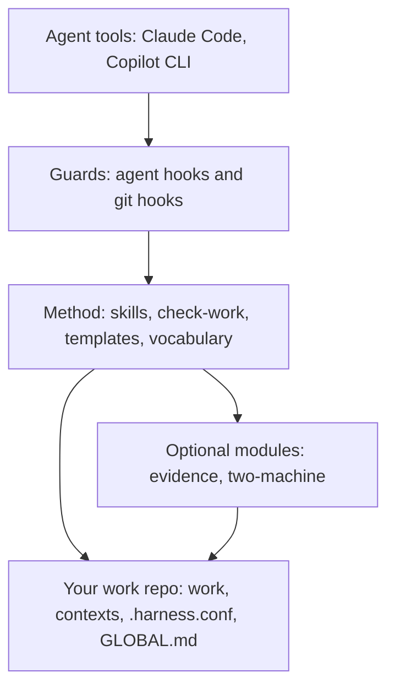

# infra-agent-harness

A safe-by-default harness for AI coding agents that work on real infrastructure, with traceable work.

> Status: first public version (0.1). It guards against mistakes, not against an adversary: read the [threat model](docs/threat-model.md) before you rely on it.

## Why

- Platform engineers often run agents (Claude Code, Copilot CLI) with cloud roles that are administrators. One wrong command is enough.
- The harness puts guards in front of the agent: hooks that block destructive commands, deny and ask rules for writes, and a read-only mode where cloud and cluster access goes through an allow-listed wrapper.
- Every finding and decision is written down as an append-only record, so another session (or another person) can resume the work cold.
- The harness is a separate repo from your work: you clone it once and point your work repo at it.

## How it fits together



- The harness (everything above the last box) lives in its own checkout. Your work repo only holds your data and a small config.
- Agent hooks guard what the agent runs. Git hooks guard what you commit.
- The method turns work into folders, records and a roadmap that a script can validate.
- Modules are off until you list them in `.harness.conf`.

Full detail and more diagrams: [docs/architecture.md](docs/architecture.md).

## What you get

- **Agent guards** (`hooks/`). With the plugin they are active as soon as it is installed (`hooks/hooks.json`); in a manual install `bin/link-harness` registers them in `~/.claude/settings.json`. Only the user changes the security profile (`bin/security-profile`); see `docs/tools.md`.
  - `ro-guard`: in read-only mode, blocks `aws`, `kubectl`, `helm`, `terraform`, `ssh`... outside `bin/ro`.
  - `block-destructive-platform`: blocks `terraform destroy`, `kubectl delete`, `aws ... delete-*`, `helm uninstall`...
  - `credential-guard`: in every mode, blocks reading, copying or sending credential files (`cat ~/.aws/credentials`, `curl -T ~/.netrc`, the Read tool on `.env`); using them (`ssh -i`, `--kubeconfig`, `source .env`) passes. The same for commands that print a secret: `gh auth token` or `aws secretsmanager get-secret-value` on the screen is blocked, piped into `docker login --password-stdin` or kept in `TOKEN=$(…)` passes.
  - `permissions.deny` / `permissions.ask` rules from `hooks/settings.base.json` and the packs (plugins cannot ship them, so `bin/link-harness` merges them into `~/.claude/settings.json` in both modes).
- **Rule packs** (`packs/`): the platform rules of the guards and `bin/ro`, one folder per technology (`aws`, `kubernetes`, `helm`, `terraform`), as data plus a small `bin/ro` check. Format and how to add one: [packs/README.md](packs/README.md).
  - Every block is appended to `~/.local/state/infra-agent-harness/hook-decisions.jsonl`.
- **Read-only executor** (`bin/ro`): one allow-listed command at a time, here or over SSH (`--host`).
- **Git hooks** (`bin/hooks/`): `commit-msg` (optional: blocks AI attribution when the repo sets `ai_attribution=block`), `prepare-commit-msg` (adds the task trailer), `pre-commit` (gitleaks, then `bin/check-work --staged`), `post-merge` and `post-rewrite` (re-run `link-harness`).
- **Method** (`docs/method.md`, `docs/method-full.md`): `bin/new-work`, `bin/check-work`, `templates/`, English and Spanish vocabulary in `locale/`.
- **Skills** (`skills/`): `new-project`, `load-project`, `close-task`, `init-context`, `troubleshoot`, `digest`, `parallel-audit`, `parallel-review`, `role`.
- **Modules** (`modules/`): `evidence` (shared evidence store, encrypted archives), `two-machine` (architect and executor on two machines).
- **Tools**: `bin/doctor` (checks a machine, read-only), `bin/denylist-scan` (used by this repo's own contributor hook and CI; `--history` checks every commit, `--quiet` never prints the matching text).

## Quick start

### As a Claude Code plugin (main path)

This repo is also its own plugin marketplace. The manual install below is the fallback. Step by step, with what you should see at each step: [docs/guide.md](docs/guide.md).

```bash
claude plugin marketplace add Jvictordevops/infra-agent-harness
claude plugin install infra-agent-harness@infra-agent-harness
```

- The plugin provides the skills and puts `bin/` (`check-work`, `new-work`, `ro`, `link-harness`...) on the PATH of the agent's Bash tool. A `SessionStart` hook keeps `~/.local/share/infra-agent-harness/current` pointing at the installed version.
- Needs `jq` (and `git`; `gitleaks` for the commit hook). The guards read every command with `jq`: without it they block every call and say why, they never let it through.
- The guards (`ro-guard`, `block-destructive-platform`, `credential-guard`) are active as soon as the plugin is installed: its `hooks/hooks.json` registers them as PreToolUse hooks (Bash; `credential-guard` also on Read and Grep). The security profile defaults to `standard` (`bin/security-profile`).
- Start one Claude Code session after installing: its `SessionStart` hook creates the stable link. Then, once, from your work repo (see the manual steps 2 and 3 below to create it), run `link-harness` from a terminal: it merges the `permissions.deny` / `permissions.ask` rules (plugins cannot ship them; it adds no hooks and removes the guard entries a previous plugin-mode run put in `~/.claude/settings.json`, backing the file up first), links `GLOBAL.md`, sets the repo's git hooks and handles Copilot. Plugin commands are only on the agent's PATH, so from a terminal use the plugin directory, for example `~/.local/share/infra-agent-harness/current/bin/link-harness` (the link exists after the first Claude Code session with the plugin). Copilot skill links always go through that stable link, never into the versioned plugin directory. If you skip `link-harness`, a second `SessionStart` hook (`hooks/install-check/install-check.sh`) says so in one line at the start of each session while any `deny` rule is missing from `~/.claude/settings.json`; with the rules in place it says nothing.
- In plugin mode `link-harness` removes only the skill links in `~/.claude/skills` that point into this harness. Links that belong to another harness (for example a private work repo with its own skills) are kept, so a skill name may appear twice: prefixed (`infra-agent-harness:close-task`) and unprefixed. `link-harness --dry-run` prints what it would change and writes nothing; `bin/doctor` uses it and never writes.
- On WSL the plugin mode does not copy skills into the Windows profile (it would overwrite skills of other harnesses): install the plugin from the Windows side with the same two `claude plugin` commands.
- For development, add your clone instead: `claude plugin marketplace add <path to your clone>` (the plugin loads in place).

### Manual install

Needs `git`, `jq` and `gitleaks`. The commit hook blocks commits when `gitleaks` is missing.

```bash
# 1. Clone the harness (anywhere; the examples use ~/infra-agent-harness)
git clone <this-repo-url> ~/infra-agent-harness

# 2. Prepare your work repo (a separate git repo)
mkdir -p ~/my-work && cd ~/my-work && git init
cp ~/infra-agent-harness/templates/GLOBAL.md GLOBAL.md        # edit the TODO profile
cp ~/infra-agent-harness/templates/root-pointer.md AGENTS.md
cp ~/infra-agent-harness/templates/root-pointer.md CLAUDE.md
mkdir -p contexts work/global

# 3. Configure the harness for this repo
printf 'language=en\nmethod=light\n# modules=evidence,two-machine\n' > .harness.conf

# 4. Point git hooks at the harness
git config core.hooksPath ~/infra-agent-harness/bin/hooks

# 5. From the work repo: install skills, this GLOBAL.md and the hooks into ~/.claude and ~/.copilot
~/infra-agent-harness/bin/link-harness

# 6. Check the machine (from the work repo, so it sees its settings)
~/infra-agent-harness/bin/doctor
```

- Then start your first work from the agent: ask for a new project and the `new-project` skill runs `bin/new-work`.
- `link-harness` is idempotent and never removes your own settings. It reads the work repo of the current directory (or `$IAH_REPO`). The `post-merge` and `post-rewrite` hooks re-run it after each pull of the work repo; after pulling the harness, run it yourself.
- Prefer the plugin install above when you use Claude Code; the manual install is the fallback (and the only way for Copilot-only machines).

## Configuration

| Setting | Where | Values | Default |
|---|---|---|---|
| `language` | `.harness.conf` | `en`, `es` (a `locale/<lang>.sh` file) | `en` |
| `method` | `.harness.conf` | `light`, `full` | `light` |
| `modules` | `.harness.conf` | comma list: `evidence`, `two-machine` | none |
| `ai_attribution` | `.harness.conf` | `allow`, `block`: with `block` the `commit-msg` hook refuses commits with AI attribution (tool `Co-authored-by` trailers, "Generated with", model names, an agent as author) | `allow` |
| `denylist` | `.harness.conf` | path, relative to the work repo, of your private denylist; `link-harness` links `~/.config/infra-agent-harness/denylist.txt` to it (read by `denylist-scan`) | none |
| `IAH_LANG`, `IAH_METHOD`, `IAH_MODULES`, `IAH_AI_ATTRIBUTION`, `IAH_DENYLIST` | environment | same as above; they win over `.harness.conf` (`IAH_DENYLIST` is the path itself) | unset |
| `IAH_REPO` | environment | path of the work repo | the git repo of the current directory |
| `evidence.conf` | `~/.config/infra-agent-harness/` | per-machine keys of the evidence module | see its README |

## Documentation

- [docs/guide.md](docs/guide.md): install, first work, read-only mode, profiles and packs, step by step.
- [docs/threat-model.md](docs/threat-model.md): what each layer stops and what it does not.
- [docs/architecture.md](docs/architecture.md): how the pieces fit, with diagrams and limits.
- [docs/method.md](docs/method.md): the light work method (default).
- [docs/method-full.md](docs/method-full.md): the full method (strict numbering).
- [docs/tools.md](docs/tools.md): reference: tool notes, read-only executors, hook registration, decision log.
- [packs/README.md](packs/README.md): rule packs, credential files, commands that show secrets.
- [modules/evidence/README.md](modules/evidence/README.md): evidence store, archives, secrets backends.
- [modules/two-machine/README.md](modules/two-machine/README.md): architect and executor protocol, SSH.

## Status and roadmap

What is described above exists in this repo, with tests under `tests/`, `packs/*/` and `modules/*/tests/`: `tests/run` runs them all and `tests/lint` runs shellcheck. CI (`.github/workflows/ci.yml`) runs both, plus gitleaks and the denylist scan of the tree and the whole history, on every push to `main`, every pull request and every release tag (macOS on release tags). Changes are listed in [CHANGELOG.md](CHANGELOG.md).

Used daily on WSL2 and macOS with Claude Code. Less tested: the two optional modules (their READMEs say which parts) and the `strict` profile on macOS.

Planned, not implemented (do not rely on any of these):

- One command parser for the three guards, so a command that only mentions a blocked one is not blocked.
- A warning at session start when `link-harness` has not been run.
- Read-only mode per work repo instead of per machine.
- `doctor --security`, environments (corporate and personal) and an IT managed policy.
- Packs for other clouds (GCP, Azure, on-prem).
- Copilot hooks (today the hooks are registered for Claude Code only).
- Container isolation (the `isolated` profile).

## Contributing and security

- [CONTRIBUTING.md](CONTRIBUTING.md): set up, tests, rules for a change.
- [SECURITY.md](SECURITY.md): how to report a vulnerability, and what the guards do not stop.

## License

[Apache-2.0](LICENSE).
