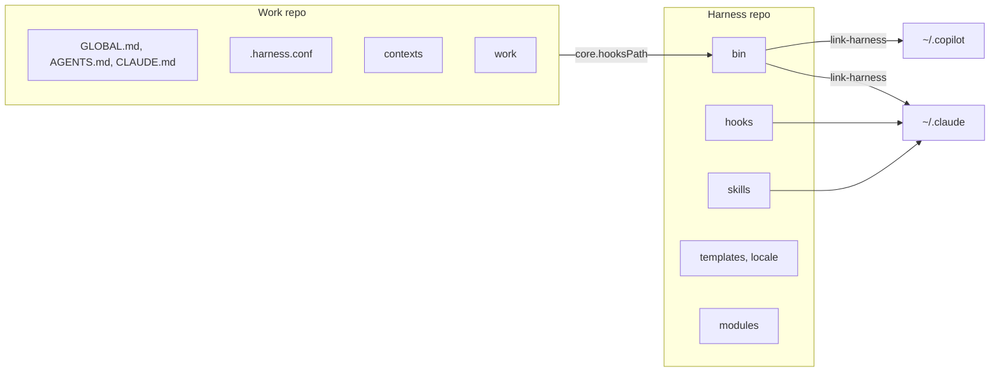
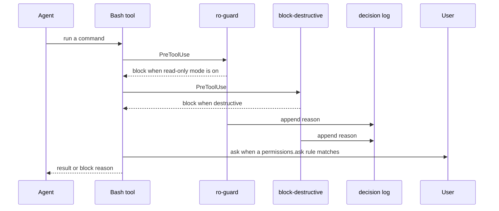
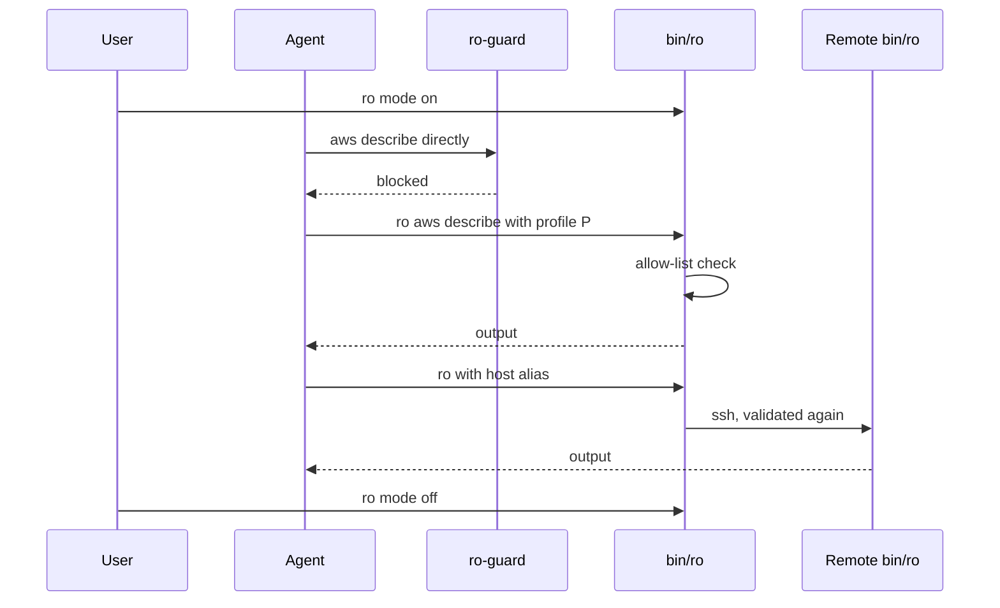
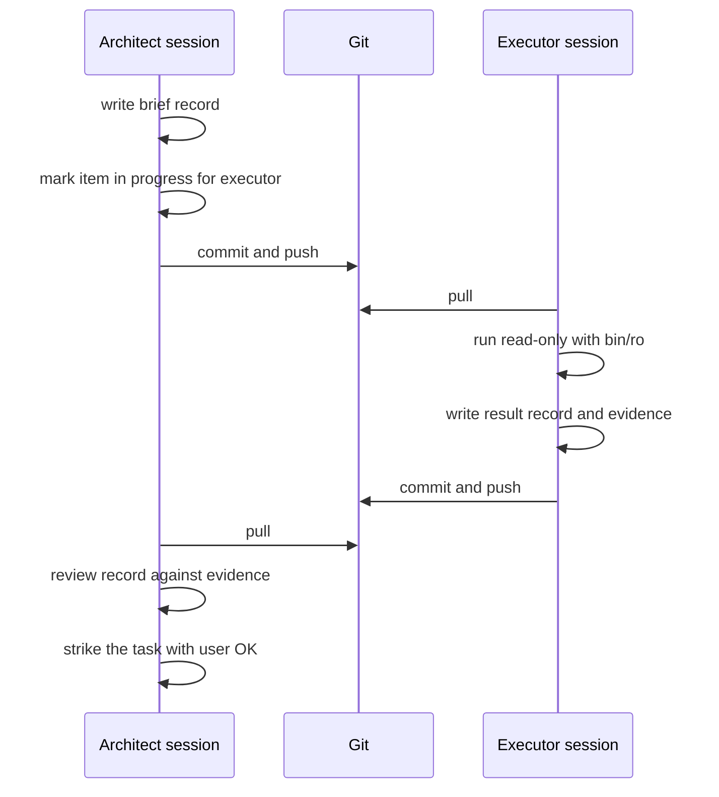
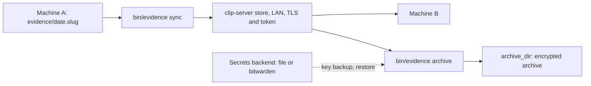

# Architecture

How the pieces of infra-agent-harness fit together. Back to the [README](../README.md).

Everything here describes code that exists in this repo. Planned items are listed only in the README roadmap.

- The **harness** is this repo: `bin/`, `hooks/`, `skills/`, `templates/`, `locale/`, `modules/`.
- Your **work repo** is a separate git repo with your instructions, contexts and works.
- The harness never lives inside the work repo. The work repo points to it with one git setting and one config file.

## 1. Harness and work repo



- Installed as a Claude Code plugin (this repo is also its own marketplace), the plugin provides the skills and puts `bin/` on the PATH of the Bash tool. A `SessionStart` hook (`hooks/stable-link/stable-link.sh`) keeps `~/.local/share/infra-agent-harness/current` pointing at the installed version, so git hooks have a path that survives updates.
- `bin/link-harness` does the rest in your home: `GLOBAL.md` becomes `~/.claude/CLAUDE.md` and `~/.copilot/copilot-instructions.md`, `hooks/settings.base.json` is merged into `~/.claude/settings.json`, the work repo's `core.hooksPath` is set, and Copilot gets the skills.
- Without the plugin (manual install), `link-harness` also symlinks the skills into `~/.claude/skills` (and `~/.copilot/skills`). In plugin mode it removes the links that point into this harness instead (links of another harness are kept), so skills are not loaded twice. `link-harness --dry-run` lists what it would change without writing; `bin/doctor` uses it.
- The merge only adds: it unions `permissions.deny` and `permissions.ask`, registers a hook only if its script is not already registered, and keeps a `.bak-<date>` copy when the file changes. It needs `jq`.
- The work repo points its git hooks at `<harness>/bin/hooks` (in plugin mode, `~/.local/share/infra-agent-harness/current/bin/hooks`) with `git config core.hooksPath`. That is the only link back to the harness. `post-merge` and `post-rewrite` re-run `link-harness` after a pull.
- On WSL, the Windows apps cannot follow WSL symlinks, so `link-harness` also copies the skills and `GLOBAL.md` (as `CLAUDE.md`) into `%USERPROFILE%\.claude`; in plugin mode it copies only `GLOBAL.md` (install the plugin from the Windows side). Hooks stay in the WSL profile. `LINK_HARNESS_WINDOWS=0` skips the copy.
- `AGENTS.md` and `CLAUDE.md` in the work repo are 3-line pointers (`templates/root-pointer.md`), so the global text is not loaded twice.
- The work repo is found from `$IAH_REPO`, or the git repo of the current directory.

## 2. Life of a work

```mermaid
flowchart LR
  np["new-project"] --> lp["load-project"]
  lp --> mark["mark task in progress"]
  mark --> rec["write records in RECORD"]
  rec --> strike["strike the task"]
  strike --> ct["close-task"]
  ct --> cw["check-work"]
  cw --> pcm["prepare-commit-msg"]
  pcm --> cm["commit-msg"]
  cm --> pc["pre-commit"]
```

A work is a folder `work/<context>/<YYYY-MM-DD.slug>/`. Skills drive it, scripts validate it.



- `new-project` runs `bin/new-work <context> <type> <slug>` and fills Goal, Objectives and the first tasks. `load-project` reads README, `LESSONS.md` and the current ROADMAP when you resume.
- Before starting a task you mark it `[~]` in the current `ROADMAP/<date>.md` and in README `## In progress`. Each finding or decision is a new file in `RECORD/`. When done, the task is struck, never deleted.
- `close-task` rewrites Status, In progress and Next steps, then runs `bin/check-work`.
- On commit, `prepare-commit-msg` adds the task trailer (`Task:`, or the word of your language) for tasks the staged files start, close or document. It never blocks.
- `commit-msg` blocks AI attribution: tool `Co-authored-by` trailers, "Generated with" lines, session trailers, model names, an agent as author.
- `pre-commit` (the one in `bin/hooks/`) runs `gitleaks` on the staged changes (the commit is blocked if `gitleaks` is not installed), then `bin/check-work --staged`. It does **not** run `denylist-scan`; that is the contributor hook of this repo (`.githooks/pre-commit`).

Anatomy of a work:

```text
work/<context>/<YYYY-MM-DD.slug>/
├── README.md     the only rewritable doc; the entry point
├── LESSONS.md    optional: traps to read first
├── RECORD/       append-only, one file per finding or decision
├── ROADMAP/      the plan, one file per revision
├── evidence/     raw data behind the records; never in git
├── scripts/      optional
├── training/     optional study units
└── .tmp/         disposable
```

## 3. A guarded command

Two `PreToolUse` hooks on the Bash tool run before every shell command the agent issues. They are registered in `~/.claude/settings.json`.



- `ro-guard` does nothing unless the read-only mode file exists. With it on, it blocks cloud, cluster and remote tools used outside `bin/ro`, and any attempt to switch the mode off. It exits with code 2 and the reason goes to the agent.
- `block-destructive-platform` matches a list of rules (`terraform destroy`, `terraform state rm`, `kubectl delete|drain|cordon`, `kubectl rollout undo`, `helm uninstall`, `helmfile apply|destroy`, `aws ... delete-|terminate-|stop-`, `aws s3 rb|rm`...) anywhere in the command, also inside `ssh '...'` or `bash -c`. It answers with a block decision and a hint to let the user run it.
- Each block appends one JSON line (time, hook, command cut to 300 characters, reason, directory) to `~/.local/state/infra-agent-harness/hook-decisions.jsonl` (mode 600). `IAH_HOOK_LOG` changes the path. Logging never makes a hook fail.
- Separately from the hooks, `hooks/settings.base.json` adds `permissions.deny` (destroy, delete, drain, uninstall, `aws s3 rb|rm`) and `permissions.ask` (force push, hard reset, `terraform apply`, `kubectl apply`, `helm install|upgrade`). `ask` means Claude Code stops and asks you.
- `hooks/confidence-nudge` (UserPromptSubmit) exists but is not in the base file; you register it yourself.

## 4. Read-only executor

For executors that must only look. Cloud roles are often admin, so the barrier is the harness, not IAM.



- `bin/ro mode on [reason]` creates `~/.config/infra-agent-harness/ro-mode` (`RO_MODE_FILE` overrides the path). From then on `ro-guard` blocks `aws`, `kubectl`, `helm`, `terraform`, `ssh`, `gh`... unless they go through `bin/ro`.
- `bin/ro` runs one command of a fixed shape: `aws <service> <read operation> --profile P`, `kubectl <read verb> --context C`, `helm list|status|history|get metadata`, `git -C <dir> log|show|diff...`, and `cat|head|tail|ls|find|grep|wc|stat` under `RO_ROOTS`. No pipes, redirections or chaining. Secrets and credentials are refused. `RO_PROFILES` and `RO_CONTEXTS` narrow it per task.
- `bin/ro --host <alias>` validates here, then runs over SSH (`BatchMode`). The remote copy (`RO_REMOTE_BIN`, default `~/infra-agent-harness/bin/ro`) validates again with its own paths and limits.
- Only the user runs `bin/ro mode off`; the hook blocks agents from doing it, sub-agents included.

## 5. Two machines

Optional module `two-machine`: one session designs and reviews, another runs things where the access is.



- Git is the only channel. Both sides write new record files, so they do not conflict.
- The architect writes README, ROADMAP, briefs and decisions. The executor writes new records and `evidence/` only.
- The delegated item in the ROADMAP is `[~]` plus the executor word and a link to the brief. The `role` skill refuses to work if `two-machine` is not in `modules=`.
- `evidence/` is not in git. Without the evidence module it stays on the machine that made it, so the result record must carry the key data in *Facts*. With the module, `role` runs `bin/evidence sync` at the start and end.

## 6. Evidence flow

Optional module `evidence`: a store shared between your own machines on your LAN.



- Each folder `evidence/<date>.<slug>/` travels as one package and is immutable once uploaded. Packages are checked with sha256 on download.
- If the store is unreachable, `sync` says it is pending and exits 0; repeat later.
- On close, `archive` syncs, encrypts, decrypts again to compare file counts, and only then deletes the copy from the store and the local `evidence/`.
- The archive is `openssl enc -aes-256-cbc` with a key file. CBC has no integrity protection: a modified archive is not detected before decryption. See the [module README](../modules/evidence/README.md), section Security notes.

## 7. Light and full method

| Check | `light` (default) | `full` |
|---|---|---|
| Layout, names, frontmatter, record names | error | error |
| Committed records edited (append-only) | error | error |
| ROADMAP open item without an id; duplicate ids | error | error |
| Other numbering rules (objectives, depth, reused ids, sections) | warning | error |
| README over 150 lines | warning | error |
| New record without a task line; `[~]` item missing from README `In progress` | warning | warning |

- `check-work` exits 1 only on errors. Works with status `closed` or `dropped` are skipped for numbering, and works marked `numbering: legacy` only get warnings.
- Use `full` when several people or agents share works and you want numbering to block commits. Rules: [method.md](method.md) and [method-full.md](method-full.md).

## 8. Configuration resolution

For each setting the first of these wins:

- `language`: `IAH_LANG`, then `language=` in `.harness.conf`, then `en`. The words come from `locale/<lang>.sh`; keys a locale omits fall back to English.
- `method`: `IAH_METHOD`, then `method=` in `.harness.conf`, then `light`. An invalid value warns and acts as `full`.
- `modules`: `IAH_MODULES` (even when empty), then `modules=` in `.harness.conf`, then none. An unknown module name only warns.
- Work repo: `IAH_REPO`, then the git repo of the current directory.
- Per machine, not per repo: `~/.config/infra-agent-harness/evidence.conf` (`IAH_EVIDENCE_CONF` changes the path), read only by the evidence module.
- `.harness.conf` and the locale files are read as data; nothing in them is executed.

## 9. What it does not protect against

- **Mistakes, not adversaries.** The hooks catch common slips. A script written on the fly (a `.sh` the agent creates and runs) is not inspected, and neither are all possible ways to spell a command.
- **Read-only is ours, not IAM.** `bin/ro` and `ro-guard` limit what the agent can run; the cloud role behind your profile is still whatever it is. Use read-only credentials too when you can.
- **Only Claude Code has the agent hooks today.** For Copilot CLI, `link-harness` installs skills and instructions, but no guards.
- **Hooks can be changed by their owner.** `~/.claude/settings.json` and the read-only mode file are yours; the harness stops agents from switching the mode off, but nothing stops you.
- **Archives have no integrity protection** (AES-256-CBC). Confidentiality depends on the key file; losing it loses the archives.
- **The LAN token is shared.** Anyone on your network with the token can read and write the evidence store and clipboard. The store is not encrypted at rest by the module.
- **Partly tested.** Podman, macOS as an evidence host, the Bitwarden backend beyond syntax, and SSH setup on Linux are marked untested in the module READMEs.
- **Commit hooks can be skipped** with `git commit --no-verify`, and `pre-commit` needs `gitleaks` installed.
- A full threat model is planned, not written.
